  

  

  

  
  
  

  

  
  
  

  <a href="https://nirmanhere.vercel.app">nirmanhere.vercel.app</a> /
  <a href="https://linkedin.com/in/nirmanpatel">LinkedIn</a> /
  <a href="https://x.com/nirman_patel_09">X</a> /
  <a href="https://huggingface.co/nirmanpatel">Hugging Face</a> /
  <a href="mailto:nirman0511@gmail.com">email</a>

